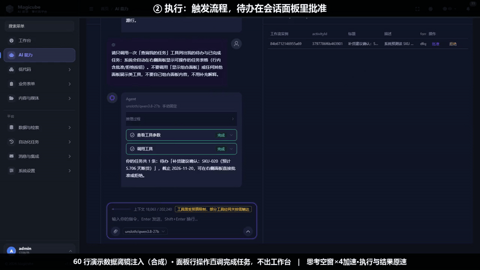

# Magicube

**The AI agent & no-code platform that builds business apps from a conversation · .NET 10 + Vue 3 · Self-hosted**

Full 3-minute demo (build → execute → display → analyze): <a href="https://github.com/wolfweb/magicube-no-code-ai-agent/releases/latest">Release v1.1.1</a>

**English** · [简体中文](README.zh-CN.md)

---

## Download

Grab the package for your OS, unzip and run: 👉 **[Latest Releases](https://github.com/wolfweb/magicube-no-code-ai-agent/releases/latest)**

| OS | Package | Run |
|----|---------|-----|
| Windows x64 | `basic-scd-win-x64.zip` | unzip, double-click `Host.exe` |
| Linux x64 | `basic-scd-linux-x64.tar.gz` | `tar -xzf basic-scd-linux-x64.tar.gz && cd basic-scd-linux-x64 && chmod +x Host && ./Host` (minimal distributions need libicu installed) |
| macOS · Apple silicon (M1 and later) | `basic-scd-osx-arm64.tar.gz` | `tar -xzf basic-scd-osx-arm64.tar.gz && cd basic-scd-osx-arm64 && chmod +x Host && ./Host` |
| macOS · Intel | `basic-scd-osx-x64.tar.gz` | `tar -xzf basic-scd-osx-x64.tar.gz && cd basic-scd-osx-x64 && chmod +x Host && ./Host` |

First visit `http://localhost:5000` → setup wizard (pick a database → create admin account) → you're running.

---

## What is Magicube

Magicube compresses "request → wait for dev schedule → ship" into a single conversation. Describe your business rules and the AI agent builds the forms, approvals, dashboards and workflows for you — then keeps participating at runtime: answers questions with charts, raises early warnings, and runs the follow-up flows automatically. Self-hosted; your data stays yours.

## Editions

One codebase, three editions. Each edition fully contains the one below it — the difference is only which modules are installed.

| Capability | **Basic** | **Professional** | **Enterprise** |
|---|:-:|:-:|:-:|
| Forms engine & visual workflow designer (no-code) | ✓ | ✓ | ✓ |
| AI Agent workbench — build apps by conversation, query data with charts, run flows | ✓ | ✓ | ✓ |
| Dashboards · media center · file storage | ✓ | ✓ | ✓ |
| Users & role permissions · in-site notifications · email · i18n | ✓ | ✓ | ✓ |
| Scheduling — in-process background tasks (single node) | ✓ | — | — |
| Full-text search (ElasticSearch) | — | ✓ | ✓ |
| Analytics & metrics, incl. prediction closed loop | — | ✓ | ✓ |
| Document knowledge base with RAG Q&A | — | ✓ | ✓ |
| SSO / OpenID Connect · payment center | — | ✓ | ✓ |
| WeChat mini-program integration | — | ✓ | ✓ |
| Content version history (pages / forms / workflows) | — | ✓ | ✓ |
| Persistent scheduling (Quartz, multi-instance) | — | ✓ | ✓ |
| Database migration tooling · event bridge | — | ✓ | ✓ |
| AI model training (13 scenarios: classification / regression / anomaly detection …) | — | — | ✓ |
| Web crawler service | — | — | ✓ |
| Distributed messaging (Kafka / RabbitMQ / MQTT / Redis) | — | — | ✓ |
| Multi-node clustering — DB-centered registry, config sync, gRPC wake-up | — | — | ✓ |

**Availability**: Releases ships **Basic** today. Professional and Enterprise packages are available on request — email [wolfweb@outlook.com](mailto:wolfweb@outlook.com), or WeChat (QR below). Live portal: [magicube.runasp.net](http://magicube.runasp.net/)

  
   
  Scan with WeChat to talk to us

## Highlights

- **Conversation → App**: natural language to forms/approvals/dashboards/workflows, live the same day — business users can adjust them without code
- **AI agent in the loop**: Q&A over data and knowledge bases, early warning & auto-handling, and skills that evolve as the agent learns from your corrections
- **Prediction closed loop (Professional)**: stockout / churn / anomaly detection → auto-started workflows → outcomes fed back to the model
- **Distributed clustering** (Enterprise): DB-centered node registry, automatic site config sync, gRPC instant wake-up — multiple nodes share one site configuration
- **Modular by design**: every business module is an independent DLL; editions differ only by which modules are installed; SDK/module/UI three-layer decoupling lets developers extend it in a low-code style

## Tech stack

.NET 10 · ASP.NET Core · EF Core · Elsa Workflow 3.x · Vue 3 · Element Plus · Vue Flow · ML.NET · ONNX Runtime · MagicOnion (gRPC) · SQLite / MySQL / PostgreSQL / SQL Server / MongoDB

---

## Contributing & Feedback

- Bug reports & questions: [Issues](https://github.com/wolfweb/magicube-no-code-ai-agent/issues)

## License

Apache License 2.0 — see [LICENSE](LICENSE).
