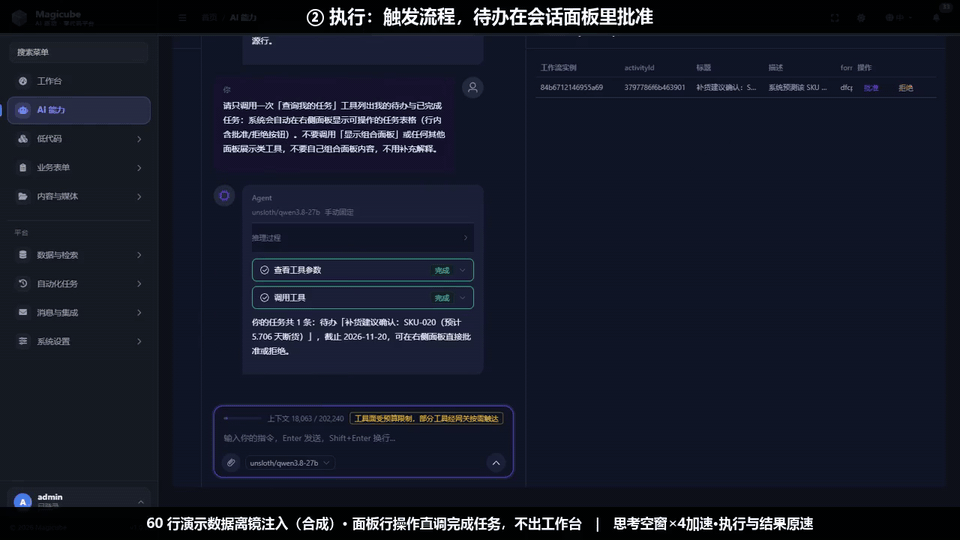

# Magicube

**AI Agent 驱动的无代码开发平台——对话即建业务应用 · .NET 10 + Vue 3 · 私有化部署**

完整 3 分钟成片（搭建 → 执行 → 展示 → 分析）：<a href="https://github.com/wolfweb/magicube-no-code-ai-agent/releases/latest">Release v1.1.1</a>

[English](README.md) · **简体中文**

---

## 下载

下载对应系统的安装包，解压后直接运行：👉 **[前往 Releases 下载](https://github.com/wolfweb/magicube-no-code-ai-agent/releases/latest)**

| 系统 | 安装包 | 运行方式 |
|------|--------|----------|
| Windows 64 位 | `basic-scd-win-x64.zip` | 解压后双击 `Host.exe` |
| Linux 64 位 | `basic-scd-linux-x64.tar.gz` | `tar -xzf basic-scd-linux-x64.tar.gz && cd basic-scd-linux-x64 && chmod +x Host && ./Host`（最小化安装的发行版需先装 libicu） |
| macOS · Apple 芯片（M1 及以上） | `basic-scd-osx-arm64.tar.gz` | `tar -xzf basic-scd-osx-arm64.tar.gz && cd basic-scd-osx-arm64 && chmod +x Host && ./Host` |
| macOS · Intel 芯片 | `basic-scd-osx-x64.tar.gz` | `tar -xzf basic-scd-osx-x64.tar.gz && cd basic-scd-osx-x64 && chmod +x Host && ./Host` |

首次访问 `http://localhost:5000` 完成安装向导（选数据库 → 设置管理员账号）即可使用。

---

## Magicube 是什么

Magicube 把「提需求 → 等排期 → 上线」压缩成一次对话。说明业务规则，AI Agent 直接把表单、审批、报表与工作流建好并发布；上线之后它继续参与运行——问数出图、提前预警、按规则自动走流程。支持私有化部署，数据留在自己手里。

## 版本（Editions）

一套代码、三个版本。高版本完整包含低版本——差异只是装哪几个模块。

| 能力 | **基础版** | **专业版** | **企业版** |
|---|:-:|:-:|:-:|
| 表单引擎 & 可视化工作流设计器（零代码） | ✓ | ✓ | ✓ |
| AI Agent 工作台——对话建应用、问数出图、跑流程 | ✓ | ✓ | ✓ |
| 数据仪表盘 · 媒体中心 · 文件存储 | ✓ | ✓ | ✓ |
| 用户与角色权限 · 站内通知 · 邮件 · 多语言 | ✓ | ✓ | ✓ |
| 定时任务——进程内后台任务（单节点） | ✓ | — | — |
| 全文检索（ElasticSearch） | — | ✓ | ✓ |
| 统计分析 & 指标，含预测闭环 | — | ✓ | ✓ |
| 文档知识库 RAG 问答 | — | ✓ | ✓ |
| SSO / OpenID Connect · 支付中心 | — | ✓ | ✓ |
| 微信小程序集成 | — | ✓ | ✓ |
| 内容版本历史（页 / 表单 / 工作流定义） | — | ✓ | ✓ |
| 持久化调度（Quartz，多实例） | — | ✓ | ✓ |
| 数据库迁移工具 · 事件桥接 | — | ✓ | ✓ |
| AI 模型训练（13 种场景：分类 / 回归 / 异常检测 …） | — | — | ✓ |
| 爬虫服务 | — | — | ✓ |
| 分布式消息总线（Kafka / RabbitMQ / MQTT / Redis） | — | — | ✓ |
| 多节点集群——DB 中心注册、配置同步、gRPC 即时唤醒 | — | — | ✓ |

**获取方式**：Releases 当前提供**基础版**下载；专业版 / 企业版按需提供——邮箱 [wolfweb@outlook.com](mailto:wolfweb@outlook.com)，或微信（下方二维码）。在线门户：[magicube.runasp.net](http://magicube.runasp.net/)

  
   
  微信扫码，直接聊业务

## 核心能力

- **对话即建应用**：自然语言 → 表单/审批/报表/工作流，当天上线，业务人员可自行调整
- **AI Agent 参与运行**：问数出图、知识库问答、业务预警与自动处理、AI 技能自演化（你的纠正会写回它的能力手册）
- **预测闭环**（专业版）：断货/流失/异常检测 → 自动发起流程 → 结论回流反哺模型
- **分布式集群**（企业版）：DB 中心节点注册 + 配置自动同步 + gRPC 即时唤醒，多节点共享一套站点配置
- **模块化架构**：每个业务模块独立 DLL，版本由所装模块决定；SDK/模块/UI 三层解耦，开发者可按低代码方式继续扩展

## 技术栈

.NET 10 · ASP.NET Core · EF Core · Elsa Workflow 3.x · Vue 3 · Element Plus · Vue Flow · ML.NET · ONNX Runtime · MagicOnion (gRPC) · SQLite / MySQL / PostgreSQL / SQL Server / MongoDB

---

## 反馈与贡献

- Bug 反馈与提问：[Issues](https://github.com/wolfweb/magicube-no-code-ai-agent/issues)

## 许可证

Apache License 2.0 — 见 [LICENSE](LICENSE)。
